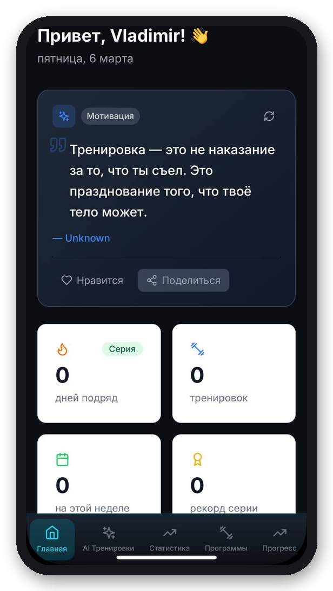
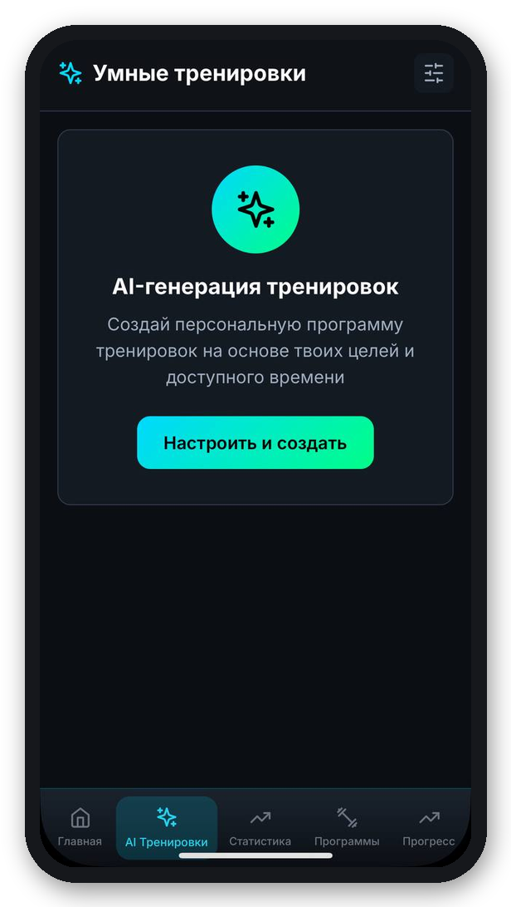
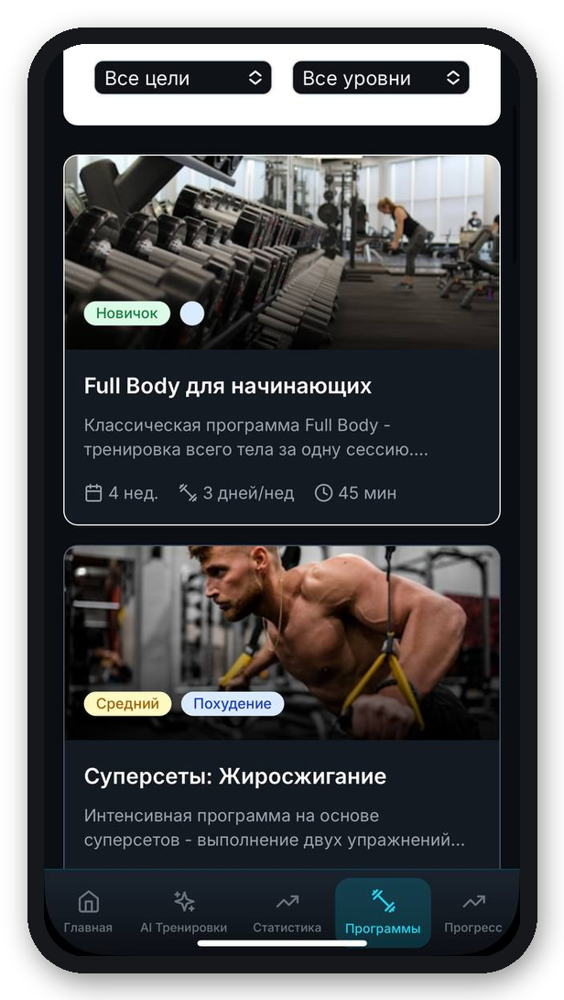
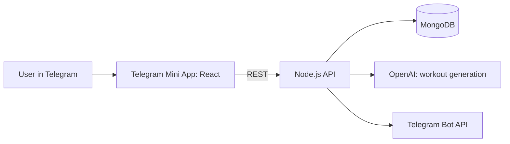

# Fit Trainer — AI fitness Telegram Mini App

Personal training plans inside Telegram — no app install. Users get an AI-generated programme from their goals and limits, track progress, and work with a coach.

  
  
  

## Key features

- **AI workout generator** — programme built from the user's metrics, goals and physical limitations.
- **Daily dashboard** — streaks, workouts, records and motivation.
- **Programme library** — filter by goal and level, start in one tap.
- **Referral tree** — multi-level invitations with automated rewards; premium subscriptions.
- **Coach dashboard (B2B)** — real-time client analytics and progress; admin ↔ coach ↔ client messaging.
- **Gamification** — challenges, streaks and achievements.

## Architecture

## Stack

React · TypeScript · Node.js · MongoDB · OpenAI API · Telegram Mini Apps SDK · Vercel · GitHub CI/CD

---
Source code is private. Built by [Vladimir Glukhov](https://www.linkedin.com/in/vladimir-glukhov-dev).
